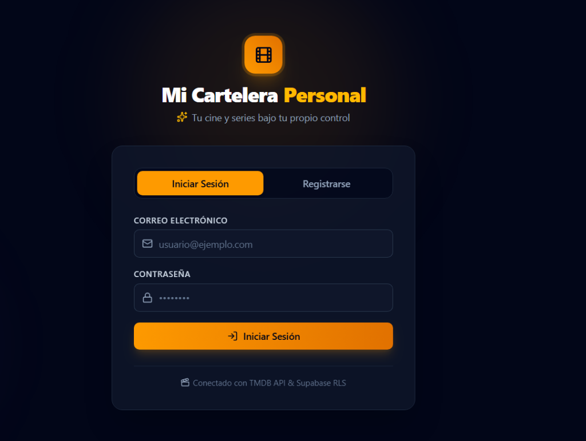
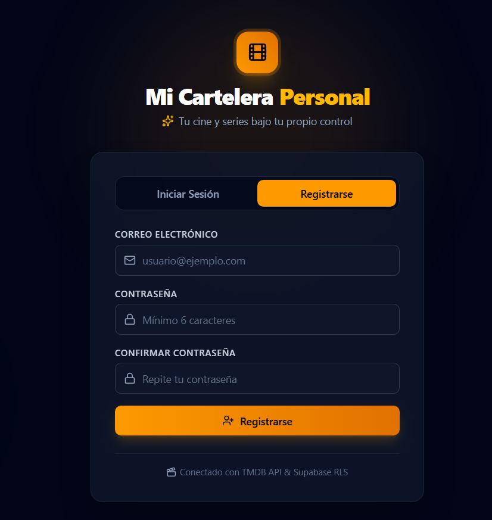
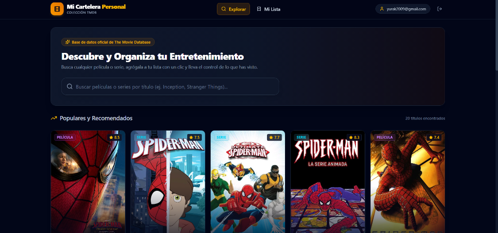
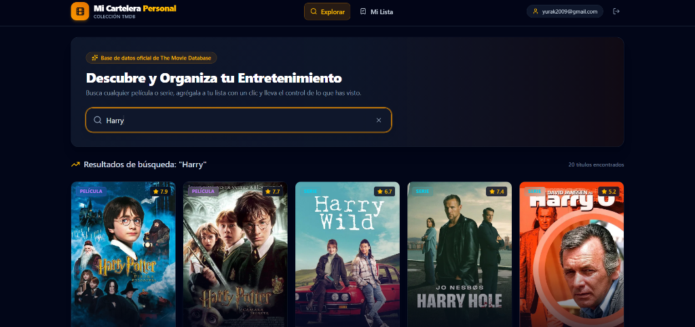
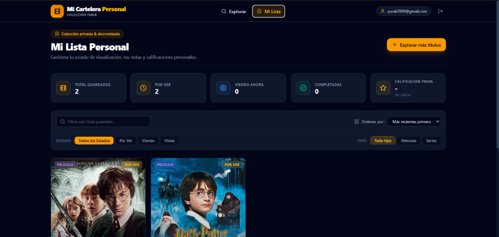

# 🎬 Mi Cartelera Personal

Aplicación web full-stack para explorar, organizar y registrar películas y series utilizando la API de **The Movie Database (TMDB)**, con persistencia y autenticación segura gestionada en **Supabase (PostgreSQL)** mediante **Row Level Security (RLS)**.

> 🌐 **App en Producción (Desplegada en Vivo):**  
> 👉 **[https://cartelera.yurakchalen.com](https://cartelera.yurakchalen.com)**

---

## 📸 Capturas de Pantalla de la Aplicación

### 1. Autenticación (Iniciar Sesión y Registro)
| Iniciar Sesión | Registro de Usuario |
| :---: | :---: |
|  |  |

### 2. Explorador de Películas y Series Populares
Exploración inicial con catálogo de tendencias y diseño responsive en tema oscuro cinematográfico:


### 3. Búsqueda Reactiva con Debounce (TMDB)
Búsqueda instantánea con `useDebounce` (400ms) que consulta la base de datos de TMDB:


### 4. Modal de Detalle con Reparto y Reseñas
Visualización de sinopsis, puntuación oficial, fotos del reparto principal y panel de notas personales:


### 5. Mi Lista Personal (Dashboard CRUD)
Gestión completa de estados (*Por Ver*, *Viendo*, *Vista*), métricas de progreso, filtros y buscador local:


---

## 🚀 Características Principales

1. **Autenticación con Supabase Auth**:
   - Registro e inicio de sesión seguro con correo y contraseña.
   - Persistencia de sesión automática con JWT y listener reactivo (`onAuthStateChange`).
   - Rutas protegidas con componente `ProtectedRoute` que redirige a `/login` si no hay sesión.

2. **Integración con The Movie Database (TMDB)**:
   - Búsqueda multi-contenido (películas y series) con manejo de estados vacíos y carga.
   - Vista detallada enriquecida con imágenes de fondo (*backdrops*), pósters, datos técnicos y reparto de actores.

3. **Dashboard de Lista Personal (Watchlist CRUD)**:
   - Registro de estados: **Por Ver**, **Viendo** y **Vista**.
   - Asignación de calificación personal interactiva de **1 a 5 estrellas**.
   - Almacenamiento de notas y comentarios personales por título.
   - Tarjetas de métricas automáticas (total, por ver, viendo, vistas y promedio de calificación).
   - Filtros combinados por estado, tipo (película/serie), ordenamiento y buscador por título.

4. **Seguridad y Arquitectura BFF (Backend-For-Frontend)**:
   - **PostgreSQL Row Level Security (RLS)**: Cada usuario únicamente puede leer, insertar, editar y eliminar sus propios registros (`auth.uid() = user_id`).
   - **Cloudflare Worker Edge Proxy**: La clave privada de TMDB se mantiene oculta en el servidor y nunca se expone en el bundle del navegador.

---

## 🛠️ Stack Tecnológico

| Capa | Tecnología | Justificación |
| :--- | :--- | :--- |
| **Frontend** | React 19 & TypeScript 6 | Componentes estrictamente tipados y hooks personalizados. |
| **Build Tooling** | Vite 8 | Compilación ESM ultrarrápida y optimización de producción. |
| **Estilos** | Tailwind CSS v4 | Estilos utilitarios modernos con tema oscuro cinemático. |
| **Enrutamiento** | React Router v7 | Enrutamiento client-side con layout compartido y guardas. |
| **Iconografía** | Lucide React | Iconos vectoriales ligeros para estados y calificaciones. |
| **Backend & DB** | Supabase (PostgreSQL) | Base de datos relacional con RLS policies activas. |
| **Despliegue** | Cloudflare Workers & Pages | Alojamiento en el borde (*edge*) con SSL automático y proxy de seguridad. |

---

## ⚙️ Instrucciones de Instalación y Ejecución Local

### Prerrequisitos
- **Node.js** v18 o superior.
- Gestor de paquetes: **pnpm** (recomendado) o **npm**.

### 1. Clonar el repositorio
```bash
git clone https://github.com/tu-usuario/deber-medio-semestre.git
cd deber-medio-semestre
```

### 2. Instalar dependencias
```bash
# Con pnpm (recomendado)
pnpm install

# O con npm
npm install
```

### 3. Configurar variables de entorno
Crea un archivo `.env.local` en la raíz del proyecto basándote en `.env.example`:

```bash
cp .env.example .env.local
```

Completa las variables requeridas en `.env.local`:
```env
# Supabase (URL y Clave Pública Anon)
VITE_SUPABASE_URL=https://tu-proyecto.supabase.co
VITE_SUPABASE_ANON_KEY=tu-anon-key-publica

# The Movie Database (TMDB)
VITE_TMDB_API_KEY=tu-api-key-de-tmdb
VITE_TMDB_BASE_URL=https://api.themoviedb.org/3
VITE_TMDB_IMAGE_BASE_URL=https://image.tmdb.org/t/p
```

### 4. Configurar la Base de Datos en Supabase
En el **SQL Editor** de tu proyecto Supabase, ejecuta el siguiente script para inicializar la tabla `mi_lista`, sus índices y políticas de seguridad:

```sql
create table public.mi_lista (
  id bigint generated always as identity primary key,
  user_id uuid references auth.users(id) on delete cascade not null default auth.uid(),
  tmdb_id integer not null,
  titulo text not null,
  poster_url text,
  tipo_contenido text not null check (tipo_contenido in ('pelicula', 'serie')),
  estado text not null check (estado in ('por_ver', 'viendo', 'vista')) default 'por_ver',
  calificacion_personal integer check (calificacion_personal between 1 and 5),
  comentario text,
  fecha_agregado timestamptz not null default now(),
  constraint unique_user_tmdb unique (user_id, tmdb_id, tipo_contenido)
);

create index mi_lista_user_id_idx on public.mi_lista (user_id);
create index mi_lista_estado_idx on public.mi_lista (user_id, estado);

alter table public.mi_lista enable row level security;

create policy "Users can read own watchlist entries"
  on public.mi_lista for select using (auth.uid() = user_id);

create policy "Users can insert own watchlist entries"
  on public.mi_lista for insert with check (auth.uid() = user_id);

create policy "Users can update own watchlist entries"
  on public.mi_lista for update using (auth.uid() = user_id) with check (auth.uid() = user_id);

create policy "Users can delete own watchlist entries"
  on public.mi_lista for delete using (auth.uid() = user_id);

grant all on table public.mi_lista to authenticated;
grant all on table public.mi_lista to service_role;
grant select on table public.mi_lista to anon;
grant usage, select on all sequences in schema public to authenticated;
```

### 5. Iniciar el servidor de desarrollo
```bash
# Con pnpm
pnpm run dev

# O con npm
npm run dev
```

Abre tu navegador en `http://localhost:5173/` para comenzar a usar la aplicación.

### 6. Compilación para Producción
```bash
pnpm run build
```

---

## 👥 Autor
- **Yurak Chalén** — Universidad San Francisco de Quito (USFQ)
- Curso: Desarrollo Web II — Deber de Medio Semestre
